# Novalyte™ AI — MCP-Powered Clinical Operating System
## Architecture Diagram

```mermaid
graph TB
    subgraph "FRONTEND UI MODULES"
        DEALFLOW["/admin/dealflow<br/>Clinic Pipeline + Revenue Intelligence"]
        MARKETINTEL["/admin/market-intel<br/>Market Trends + Competitor Heatmaps"]
        WORKFORCE["/admin/workforce<br/>Staffing + Shift-Matching Engine"]
    end

    subgraph "MCP SERVER LAYER"
        MCP_DEALFLOW["novalyte-dealflow-mcp<br/>• get_clinic_pipeline<br/>• get_regional_demand_spikes<br/>• rank_clinics_by_opportunity"]
        MCP_MARKET["novalyte-market-intel-mcp<br/>• get_treatment_trend_map<br/>• get_competitor_density<br/>• list_high_performing_products"]
        MCP_WORKFORCE["novalyte-workforce-mcp<br/>• find_available_staff<br/>• match_shifts_to_staff<br/>• alert_clinic_staffing_gap"]
        MCP_BIGQUERY["BigQuery MCP<br/>Query demand, intent, events"]
        MCP_POSTGRES["PostgreSQL MCP<br/>Read/write clinic, staff, vendor data"]
        MCP_WEBSEARCH["Web Search MCP<br/>Competitor + market research"]
        MCP_GMAIL["Gmail MCP<br/>Clinic/vendor outreach"]
        MCP_SLACK["Slack MCP<br/>Internal operational alerts"]
        MCP_TWILIO["Twilio MCP<br/>SMS activation layer"]
    end

    subgraph "INTELLIGENCE LAYER - Vertex AI"
        VERTEX_DEMAND["Demand Spike Detection<br/>• Regional trend analysis<br/>• Treatment demand forecasting"]
        VERTEX_RANKING["Clinic Ranking Models<br/>• Opportunity scoring<br/>• Revenue potential analysis"]
        VERTEX_MATCHING["Workforce Matching Engine<br/>• Staff-shift compatibility<br/>• Skill alignment scoring"]
        VERTEX_TRENDS["Treatment Trend Analysis<br/>• Market movement detection<br/>• Competitor pattern recognition"]
    end

    subgraph "DATA LAYER"
        BQ_DEMAND["BigQuery Datasets<br/>• Demand signals<br/>• Intent tracking<br/>• Regional spikes<br/>• Event streams"]
        PG_CLINICS["PostgreSQL<br/>• Clinics<br/>• Staff profiles<br/>• Vendors<br/>• Shifts<br/>• Pipeline data"]
        EXT_STAFFING["External APIs<br/>• Staffing platforms<br/>• Job boards<br/>• Temp agencies"]
        EXT_VENDORS["External APIs<br/>• Vendor catalogs<br/>• Pricing data<br/>• Product availability"]
        EXT_COMPETITORS["External APIs<br/>• Competitor sites<br/>• Ad intelligence<br/>• Market data"]
    end

    subgraph "ACTIVATION LAYER"
        ACT_GMAIL["Gmail<br/>Clinic/Vendor Outreach<br/>• Email campaigns<br/>• Follow-up sequences"]
        ACT_SLACK["Slack<br/>Internal Alerts<br/>• Demand spikes<br/>• Staffing gaps<br/>• Revenue alerts"]
        ACT_TWILIO["Twilio<br/>SMS Activation<br/>• Staff notifications<br/>• Clinic alerts<br/>• Urgent communications"]
    end

    %% User to Frontend
    USER[Superadmin<br/>Kaizen] --> DEALFLOW
    USER --> MARKETINTEL
    USER --> WORKFORCE

    %% Frontend to MCP Servers
    DEALFLOW -->|API Calls| MCP_DEALFLOW
    MARKETINTEL -->|API Calls| MCP_MARKET
    WORKFORCE -->|API Calls| MCP_WORKFORCE

    %% MCP Servers to Data Layer
    MCP_DEALFLOW -->|Query| BQ_DEMAND
    MCP_DEALFLOW -->|Read/Write| PG_CLINICS
    MCP_DEALFLOW -->|Scrape| EXT_COMPETITORS
    
    MCP_MARKET -->|Query| BQ_DEMAND
    MCP_MARKET -->|Search| MCP_WEBSEARCH
    MCP_MARKET -->|Read| PG_CLINICS
    MCP_WEBSEARCH -->|Fetch| EXT_COMPETITORS
    
    MCP_WORKFORCE -->|Read/Write| PG_CLINICS
    MCP_WORKFORCE -->|Query| EXT_STAFFING
    MCP_WORKFORCE -->|Read| BQ_DEMAND

    %% MCP Servers to Intelligence Layer
    MCP_DEALFLOW -->|Analyze| VERTEX_DEMAND
    MCP_DEALFLOW -->|Rank| VERTEX_RANKING
    MCP_MARKET -->|Analyze| VERTEX_TRENDS
    MCP_WORKFORCE -->|Match| VERTEX_MATCHING

    %% Intelligence Layer to Data Layer
    VERTEX_DEMAND -->|Read| BQ_DEMAND
    VERTEX_RANKING -->|Read| PG_CLINICS
    VERTEX_RANKING -->|Read| BQ_DEMAND
    VERTEX_MATCHING -->|Read| PG_CLINICS
    VERTEX_TRENDS -->|Read| BQ_DEMAND

    %% MCP Servers to BigQuery/PostgreSQL MCP
    MCP_DEALFLOW -.->|Delegate| MCP_BIGQUERY
    MCP_MARKET -.->|Delegate| MCP_BIGQUERY
    MCP_BIGQUERY -->|Query| BQ_DEMAND
    
    MCP_DEALFLOW -.->|Delegate| MCP_POSTGRES
    MCP_WORKFORCE -.->|Delegate| MCP_POSTGRES
    MCP_POSTGRES -->|Query| PG_CLINICS

    %% MCP Servers to Activation Layer
    MCP_DEALFLOW -->|Trigger| MCP_GMAIL
    MCP_MARKET -->|Trigger| MCP_GMAIL
    MCP_WORKFORCE -->|Trigger| MCP_SLACK
    MCP_DEALFLOW -->|Alert| MCP_SLACK
    MCP_WORKFORCE -->|Notify| MCP_TWILIO

    %% Activation MCPs to Services
    MCP_GMAIL -->|Send| ACT_GMAIL
    MCP_SLACK -->|Post| ACT_SLACK
    MCP_TWILIO -->|Send| ACT_TWILIO

    %% Results back to Frontend
    MCP_DEALFLOW -.->|Results| DEALFLOW
    MCP_MARKET -.->|Results| MARKETINTEL
    MCP_WORKFORCE -.->|Results| WORKFORCE

    %% Styling
    classDef frontend fill:#1e3a8a,stroke:#3b82f6,stroke-width:2px,color:#fff
    classDef mcp fill:#7c3aed,stroke:#a78bfa,stroke-width:2px,color:#fff
    classDef intelligence fill:#059669,stroke:#10b981,stroke-width:2px,color:#fff
    classDef data fill:#dc2626,stroke:#ef4444,stroke-width:2px,color:#fff
    classDef activation fill:#ea580c,stroke:#f97316,stroke-width:2px,color:#fff
    classDef user fill:#1f2937,stroke:#4b5563,stroke-width:2px,color:#fff

    class DEALFLOW,MARKETINTEL,WORKFORCE frontend
    class MCP_DEALFLOW,MCP_MARKET,MCP_WORKFORCE,MCP_BIGQUERY,MCP_POSTGRES,MCP_WEBSEARCH,MCP_GMAIL,MCP_SLACK,MCP_TWILIO mcp
    class VERTEX_DEMAND,VERTEX_RANKING,VERTEX_MATCHING,VERTEX_TRENDS intelligence
    class BQ_DEMAND,PG_CLINICS,EXT_STAFFING,EXT_VENDORS,EXT_COMPETITORS data
    class ACT_GMAIL,ACT_SLACK,ACT_TWILIO activation
    class USER user
```



## Data Flow

### 1. User Request Flow
```
Superadmin → Admin UI → MCP Server → Data/Vertex AI → Results → Admin UI → User
```

### 2. Intelligence Flow
```
MCP Server → Vertex AI → Data Analysis → Insights → MCP Server → Admin UI
```

### 3. Activation Flow
```
MCP Server → Detection/Alert → Activation MCP → External Service → Recipient
```

## Component Details

### Frontend UI Modules
- **/admin/dealflow**: Clinic pipeline visualization, revenue intelligence, opportunity ranking
- **/admin/market-intel**: Market trend maps, competitor density analysis, product performance
- **/admin/workforce**: Staff availability, shift matching, staffing gap alerts

### MCP Server Layer
- **Custom Novalyte MCPs**: 3 servers with 9 total tools
- **External MCPs**: 6 servers for data access and activation
- **Total**: 9 MCP servers, 15+ tools

### Intelligence Layer (Vertex AI)
- **Demand Spike Detection**: Regional trend analysis, treatment forecasting
- **Clinic Ranking**: Opportunity scoring, revenue potential
- **Workforce Matching**: Staff-shift compatibility, skill alignment
- **Treatment Trends**: Market movement, competitor patterns

### Data Layer
- **BigQuery**: Event streams, demand signals, intent tracking
- **PostgreSQL**: Operational data (clinics, staff, vendors, shifts)
- **External APIs**: Staffing platforms, vendor catalogs, competitor intelligence

### Activation Layer
- **Gmail**: Automated outreach campaigns
- **Slack**: Real-time operational alerts
- **Twilio**: SMS notifications for urgent communications

